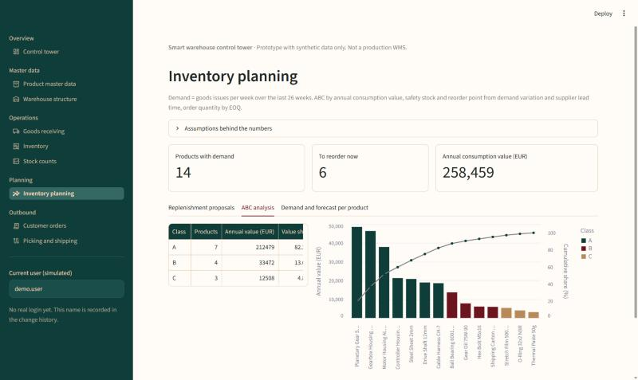
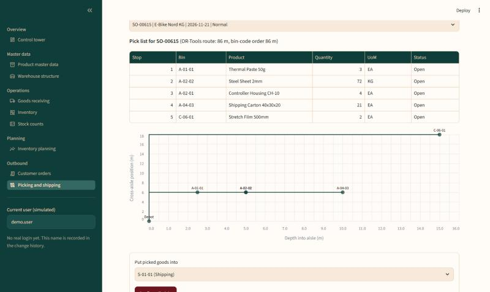
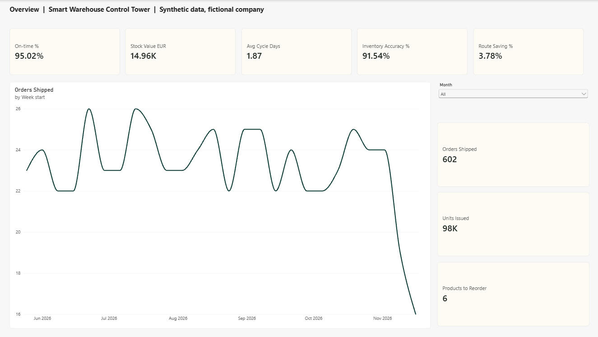
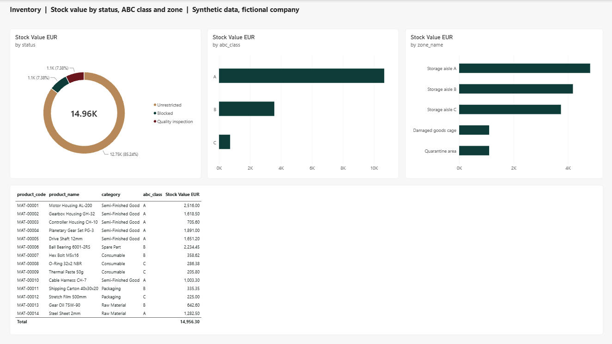

# Smart Warehouse, Inventory Accuracy & Intralogistics Control Tower

A warehouse management prototype for a **fictional** German manufacturing and
distribution company, built with Python, Streamlit and SQLite. All data is
synthetic. This is a portfolio prototype, not a production-ready WMS.


| Inventory planning (ABC analysis) | Picking route (OR-Tools) |
|---|---|
|  |  |

## The problem

In many warehouses, the stock in the system does not match the stock on the
shelf. Products are registered twice, data is entered inconsistently, and
changes happen without anyone being able to trace them. Every later decision
(replenishment, picking, stock counts) inherits these errors.

This application is built around one rule: **no data changes without
validation and a recorded history.**

## What it does

**Control tower** (start page)
- KPIs for service (on-time shipping, cycle time, overdue orders), inventory
  (accuracy, stock value, quarantined value, reorder needs) and process
  (pending approvals, route saving, ledger differences).
- Alerts that point to stock, bins and orders needing action, and weekly trends.
- Export of nine CSV tables (star schema) for a Power BI report, with a
  step-by-step guide in `docs/POWER_BI_GUIDE.md`.

**Product master data**
- Register products with category, unit of measure, unit cost, supplier and
  lead time. The system assigns each product a unique ID (`MAT-00001`).
- Reject invalid input with clear messages, such as a negative cost, a
  lead time over 365 days or missing fields.
- Prevent duplicate products, even when the name differs only in capital
  letters or extra spaces.
- Search by product ID, name, category or supplier.
- Edit products, with a full change history: every changed field is recorded
  with its old value, new value, user and timestamp.

**Warehouse structure**
- Define zones by purpose: receiving, storage, picking, shipping, quarantine
  and damaged goods.
- Create storage bins one at a time or a whole rack and level range at once.
  The system generates every bin code (`A-01-02` = zone A, rack 1, level 2),
  so there are no hand-typed variants of the same location.

**Goods receiving**
- Post goods receipts against a delivery note, into a receiving bin, or
  straight into quarantine or damaged goods if the delivery fails the check.
- Put goods away with a suggested bin: one that already holds the product,
  otherwise the first empty storage bin.

**Inventory**
- Stock per product and bin, with its status. Only stock in storage and
  picking zones counts as available. Quarantined and damaged stock never does.
- Move stock between bins by typing or scanning bin codes.
- A movement ledger records every change with source bin, destination bin,
  quantity, user and time.
- A ledger check rebuilds all stock from the movements and reports any
  difference, which would mean stock was changed without a movement.

**Stock counts and discrepancies**
- Blind counts: the counter does not see the expected quantity.
- Physical and system quantities are stored side by side. Every difference
  needs a reason.
- Small differences (within 5 % and 50 EUR) are adjusted automatically. Larger
  ones need approval by a second person, who cannot be the counter.
- Investigation hints point to records and processes to check (other bins,
  unposted movements), never to people.
- Inventory accuracy: the share of counts within tolerance.

**Customer orders**
- Orders with several lines, a requested date and a priority.
- Availability to promise: unrestricted stock minus what released orders
  already reserved. Quarantined and blocked stock is never promised.
- Release reserves the stock only if every line is available, and names the
  shortage otherwise. Cancelling needs a reason and frees the reservation.

**Picking and shipping**
- Pick lists for released orders, taking stock from pick-face bins first.
- The walking route is optimised with Google OR-Tools and compared with a
  list sorted by bin code; distances come from a simplified, simulated layout.
- Confirming the picks moves the stock to the shipping area; shipping posts
  the goods issue and closes the order.

**Inventory planning**
- Weekly demand from goods issues, with a moving-average and an
  exponential-smoothing forecast; the one with the lower error is used.
- ABC analysis, safety stock, reorder point and economic order quantity,
  with the service level set by ABC class.
- Replenishment proposals for products at or below their reorder point. All
  assumptions are shown on screen.

## Run it

```powershell
py -V:3.13 -m venv .venv
.\.venv\Scripts\Activate.ps1
python -m pip install -r requirements.txt
streamlit run app.py
```

Run the tests:

```powershell
python -m pytest -v
```

## Demo data

`scripts/seed_demo_data.py` simulates 26 weeks of a fictional warehouse
(receipts, putaway, orders, picking, shipping, cycle counts and approvals)
through the same functions the app uses. It writes a separate database and
never touches your own data.

```powershell
python scripts/seed_demo_data.py
$env:WAREHOUSE_DB = "data/demo_warehouse.db"; streamlit run app.py
```

Example run (seed 42, generated on 2026-11-20): 617 orders (602 shipped,
95.0 % on time, 1.9 days average cycle time), 130 cycle counts with 91.5 %
inventory accuracy, 0 ledger differences, and 3.8 % shorter picking routes
than bin-code order. The simulated period ends on the day you run the script,
so the figures differ slightly from run to run. These are results of a
simulation, not of a real warehouse.

## Power BI report

A four-page management report built in Power BI Desktop on the exported demo
data: overview, inventory, inventory accuracy and replenishment.
[PDF](docs/powerbi/warehouse_report.pdf) ·
[.pbix](docs/powerbi/warehouse_report.pbix) ·
[how it was built](docs/POWER_BI_GUIDE.md)



| Inventory | Inventory accuracy |
|---|---|
|  |  |

The report's figures match the app's control tower on the same database.

## How it is built

- **Two layers of validation.** Python checks give the user clear messages,
  and database constraints act as the last line of defence.
- **Changes and their history are saved in one database transaction.** Either
  both are saved or neither is, so the history can never drift out of sync.
- **Stock changes only through one function** that writes the movement and
  the stock change together, and refuses negative stock, blocked bins and
  moving more than is in a bin.
- **Parameterised SQL queries** throughout, which protects against SQL injection.
- **Business logic separated from the user interface.** The rules in
  `warehouse/` are tested without opening the app.
- **162 automated tests** (pytest), run against a temporary database so real
  data is never touched.

## Project structure

```
app.py                      entry point and navigation
app_pages/                  one screen per business process
warehouse/
  database.py               database connection and table definitions
  products.py               product validation, search, edit, change history
  locations.py              zones, bins and bin codes
  inventory.py              stock, movements, availability, ledger check
  receiving.py              goods receipts and putaway suggestions
  counts.py                 stock counts, tolerance, approvals, accuracy
  orders.py                 customer orders, availability to promise, release
  picking.py                pick lists, OR-Tools route, picking, goods issue
  planning.py               demand, forecast, ABC, safety stock, ROP, EOQ
  analytics.py              KPIs, alerts, trends, Power BI export
  labels.py                 readable dropdown labels
scripts/
  seed_demo_data.py         26-week synthetic demo warehouse
  export_power_bi.py        CSV export for the Power BI report
tests/                      pytest tests on a temporary database
docs/                       progress log, diagrams, Power BI guide, theme and report
```

## Limitations

- There is no real login. The user name is typed in and not authenticated.
- Unit cost is stored as a rounded floating-point number. Enterprise systems
  use exact decimal types for money.
- Bin capacity (size, weight) is not modelled yet.
- Purchase orders are not modelled; replenishment is proposed, not ordered.
- Walking distances use a simplified layout model (one aisle per zone, front
  and rear cross-aisles).

## Technology

Python 3.13 · Streamlit · SQLite · Pandas · Google OR-Tools · Altair · pytest · Power BI
