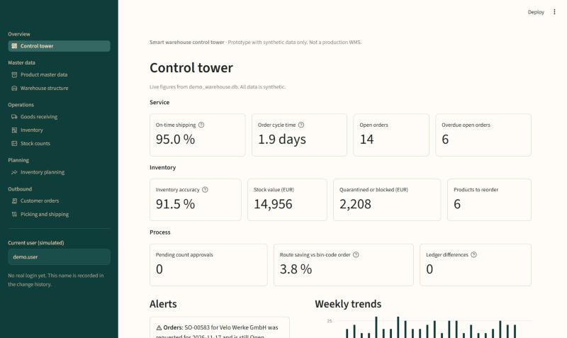
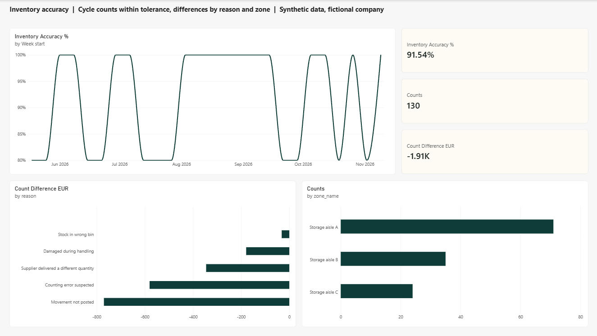

# Smart Warehouse & Inventory Control Tower

A warehouse management prototype I built during my M.Sc. at RWTH Aachen. It
runs a small, made-up warehouse for a fictional German manufacturer, from the
moment goods arrive to the moment an order ships. All data is synthetic.



| Inventory planning (ABC analysis) | Pick list with walking route |
|---|---|
|  |  |

## Why I built it

Most inventory problems start in the same place: the stock in the system and
the stock on the shelf drift apart. Someone moves a pallet and forgets to book
it, a delivery is short, a count is off. Every later decision, from
replenishment to picking, then works with wrong numbers.

So the whole app follows one rule. Stock never changes without a recorded
movement, and every movement stores where it came from, where it went, how
much, who did it and when.

## What it does

The app is split into the pages a warehouse would actually use:

- **Product master data.** Products get an ID like `MAT-00001`, duplicates are
  blocked, and every edit is logged with old and new value.
- **Warehouse structure.** Zones for receiving, storage, picking, shipping,
  quarantine and damaged goods. Bin codes such as `A-01-02` are generated, so
  nobody types locations by hand.
- **Goods receiving.** Receipts against a delivery note, with quarantine for
  deliveries that fail the check, and a suggested bin for putaway.
- **Inventory.** Stock per bin and status, transfers by scanning or typing bin
  codes, and the full movement ledger. A ledger check rebuilds all stock from
  the movements and flags anything that doesn't add up.
- **Stock counts.** Blind counts, so the counter doesn't see the expected
  number. Small differences are adjusted automatically; bigger ones need a
  second person to approve, and that person can't be the one who counted.
- **Customer orders.** Orders only get released if the stock is really
  available. Quarantined or damaged stock is never promised.
- **Picking and shipping.** Pick lists with a walking route optimised with
  Google OR-Tools, compared against a list sorted by bin code.
- **Inventory planning.** Weekly demand, a simple forecast, ABC analysis,
  safety stock, reorder points and order quantities.
- **Control tower.** The KPIs on one page (on-time shipping, inventory
  accuracy, stock value, open approvals) plus an export for Power BI.

## Power BI report

I built a four-page management report in Power BI Desktop on top of the
exported data: overview, inventory, inventory accuracy and replenishment.
Its numbers match the control tower page in the app.

[PDF version](docs/powerbi/warehouse_report.pdf) ·
[.pbix file](docs/powerbi/warehouse_report.pbix) ·
[how I built it](docs/POWER_BI_GUIDE.md)


| Inventory | Inventory accuracy |
|---|---|
|  |  |

## Results from the demo data

`scripts/seed_demo_data.py` simulates 26 weeks of warehouse activity through
the same functions the app uses. In the run shown in the screenshots, 602 of
617 orders were shipped, 95 % of them on time, inventory accuracy was 91.5 %,
and the OR-Tools routes were 3.8 % shorter than walking the bins in code order.
These are simulation results, not numbers from a real warehouse.

## How it's built

Python with Streamlit for the screens and SQLite for the data. The business
rules live in `warehouse/` and don't depend on the screens, so they can be
tested on their own: there are 162 tests (pytest), all running on a temporary
database. Changes and their history are written in one database transaction,
so the log can't get out of sync with the data, and every SQL query is
parameterised.

```
app.py              entry point and navigation
app_pages/          one page per process
warehouse/          business logic (products, bins, stock, receiving,
                    counts, orders, picking, planning, KPIs)
scripts/            demo data generator and Power BI export
tests/              pytest tests
docs/               process diagram, Power BI guide and report
```

## Running it

You need Python 3.13. In the project folder:

```powershell
py -V:3.13 -m venv .venv
.\.venv\Scripts\Activate.ps1
python -m pip install -r requirements.txt
streamlit run app.py
```

That starts the app with an empty warehouse. To see it with half a year of
activity instead, generate the demo data first and point the app at it:

```powershell
python scripts/seed_demo_data.py
$env:WAREHOUSE_DB = "data/demo_warehouse.db"; streamlit run app.py
```

The tests run with `python -m pytest`.

## What it doesn't do (yet)

There's no real login; the user name is typed into the sidebar. Bin capacity,
purchase orders and partial picking aren't modelled. Walking distances come
from a simplified layout (one aisle per zone, front and rear cross-aisles),
not from a real floor plan.

Next up is production planning with SAP PP concepts, built on the same data.

Python · Streamlit · SQLite · pandas · Google OR-Tools · pytest · Power BI
